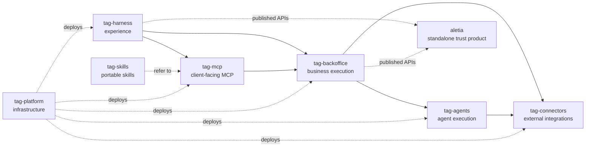

# theapotheosisgroup/.github

The organization-wide repository of The Apotheosis Group. It holds:

- the public organization profile ([`profile/README.md`](profile/README.md));
- the engineering standards every TAG repository follows ([`standards/`](standards/README.md));
- the shared, reusable GitHub Actions workflows ([`.github/workflows/`](.github/workflows/)) and the workflow templates that call them ([`workflow-templates/`](workflow-templates/));
- the default community health files: [contributing guide](CONTRIBUTING.md), [security policy](SECURITY.md), [code of conduct](CODE_OF_CONDUCT.md), [issue templates](.github/ISSUE_TEMPLATE/) and the [pull request template](.github/pull_request_template.md).

**This repository is public.** It holds policy and interfaces only. Architecture, deployment, identity and security details of the platform live in private repositories (see [Where the other documents live](#where-the-other-documents-live)).

## How the organization is structured

TAG is an agent-first, organization-to-organization back-office platform. Its code is split into repositories with one owner per domain. Each repository publishes its contracts, and the others depend on those contracts rather than on its internals. The standards that govern these boundaries are in [`standards/ARCHITECTURE.md`](standards/ARCHITECTURE.md).

Arrows are logical dependencies on published contracts, not network permissions. aletia is a separate product; TAG uses it only through its published APIs.

## Repository catalogue

This table is the canonical list. Visibility is **Public** or **Private**. Status uses the labels defined in [`standards/DOCUMENTATION.md`](standards/DOCUMENTATION.md#status-labels).

### Organization

| Repository | Visibility | Responsibility | Status |
| --- | --- | --- | --- |
| `.github` | **Public** | Organization profile, engineering standards, reusable workflows, templates and community defaults | Active |
| `.github-private` | Private | Member-only organization profile | Active |

### New TAG repositories

Created in phase R01. Each holds a scaffold only until its migration phase lands; none is implemented or deployed yet.

| Repository | Visibility | Responsibility | Status |
| --- | --- | --- | --- |
| `aletia` | Private | Standalone trust and business-record product (parties, Nexuses, permissions, append-only ledger). TAG consumes it through its published APIs. | Proposed but not implemented |
| `tag-agents` | Private | Agent definitions and capability metadata, general-purpose agent execution and agent identity | Proposed but not implemented |
| `tag-connectors` | Private | External provider APIs, provider credential custody and vendor adapters | Proposed but not implemented |
| `tag-skills` | Private | Installable skills in the open Agent Skills format | Proposed but not implemented |
| `tag-mcp` | Private | Client-facing MCP servers: discovery, authorization metadata, routing and tool exposure | Proposed but not implemented |

### Existing TAG repositories (kept and aligned)

| Repository | Visibility | Responsibility | Status |
| --- | --- | --- | --- |
| `tag-harness` | Private | Personal workspace experience: conversations, work, documents, organization context | Active |
| `tag-backoffice` | Private | Finance, People and Governance business execution | Active |
| `tag-platform` | Private | Infrastructure as code, environments and deployment topology: the single infrastructure authority | Active |
| `tag-brand` | Private | Brand mark and design tokens | Active |
| `tag-website` | Private | Marketing website | Active |

### Legacy repositories

Migration sources. They are preserved unchanged: not renamed, archived or deleted, and the reorganization does not commit to them.

| Repository | Visibility | Responsibility | Status |
| --- | --- | --- | --- |
| `tag-mvp-ux` | Private | Original platform application; source for `aletia`, `tag-agents` and part of `tag-connectors` | Deprecated or legacy |
| `TAG-Gateway` | Private | Original vendor gateway; primary source for `tag-connectors` | Deprecated or legacy |
| `truss-interfaces` | Private | Original client and firm portals | Deprecated or legacy |
| `xero-mcp-server` | Private | Original accounting-provider MCP server; source for `tag-connectors` and `tag-mcp` | Deprecated or legacy |
| `truss-mobile` | Private | Dormant mobile prototype, kept for reference | Deprecated or legacy |
| `cardano-api`, `escrow-plutus`, `marlowe-test`, `equipment-payment` | Private | 2022 experiments, not part of TAG | Deprecated or legacy |

**Which repositories may be public.** Repositories are private by default. SDKs and other repositories meant for end users or external developers may be made public, each by its own ADR ([`standards/REPOSITORIES.md`](standards/REPOSITORIES.md#visibility)).

## Engineering standards

The [standards index](standards/README.md) maps each of the 20 required conventions to the file that defines it.

| Standard | Covers |
| --- | --- |
| [ARCHITECTURE](standards/ARCHITECTURE.md) | Principles, ownership, dependency rules, module boundaries |
| [REPOSITORIES](standards/REPOSITORIES.md) | Naming, required files, visibility, branches and pull requests |
| [CODE-STYLE](standards/CODE-STYLE.md) | Style per language, package managers, dependency locking and upgrades |
| [API-CONTRACTS](standards/API-CONTRACTS.md) | Contract ownership, OpenAPI and JSON Schema, compatibility |
| [AGENTS-AND-SKILLS](standards/AGENTS-AND-SKILLS.md) | Agent definitions, registry, plugin format, skills, coding agents |
| [MCP-STANDARDS](standards/MCP-STANDARDS.md) | MCP ownership, authorization and testing |
| [IDENTITY-AND-AUTH](standards/IDENTITY-AND-AUTH.md) | Authentication, delegated authorization, DIDs |
| [TESTING](standards/TESTING.md) | Test levels and minimum security coverage |
| [CI-CD](standards/CI-CD.md) | Blocking CI, shared workflows, pinning, releases, administrator steps |
| [TERRAFORM](standards/TERRAFORM.md) | Infrastructure code, modules and state ownership |
| [SECURITY](standards/SECURITY.md) | Secrets, supply chain, vulnerabilities and incident response |
| [OBSERVABILITY](standards/OBSERVABILITY.md) | Logging, tracing and correlation IDs |
| [DOCUMENTATION](standards/DOCUMENTATION.md) | Required documents, ADRs and status labels |
| [RELEASES](standards/RELEASES.md) | Versioning, deprecation, release and rollback |

Decisions behind the standards are recorded as ADRs in [`docs/adr/`](docs/adr/).

## Shared workflows

Other repositories call these with `uses: theapotheosisgroup/.github/.github/workflows/<file>@<sha>`. Inputs, pinning rules and required permissions are in [`standards/CI-CD.md`](standards/CI-CD.md#shared-workflows).

| Workflow | Purpose |
| --- | --- |
| [`reusable-node-ci.yml`](.github/workflows/reusable-node-ci.yml) | Node.js and TypeScript: lockfile install with the repository's own npm or pnpm, format, lint, typecheck, unit and contract tests, build |
| [`reusable-python-ci.yml`](.github/workflows/reusable-python-ci.yml) | Python with uv: `uv sync --frozen`, Ruff, Pyright, import boundaries, pytest, contract tests |
| [`reusable-container-ci.yml`](.github/workflows/reusable-container-ci.yml) | hadolint, image build without push, Trivy scan, SBOM artifact |
| [`reusable-terraform-ci.yml`](.github/workflows/reusable-terraform-ci.yml) | Terraform or OpenTofu: fmt, validate, TFLint, Trivy policy scan; no credentials |
| [`reusable-security.yml`](.github/workflows/reusable-security.yml) | gitleaks secret scanning, OSV-Scanner vulnerabilities and license policy, optional dependency review |

This repository proves each one runs: [`self-test.yml`](.github/workflows/self-test.yml) calls every reusable workflow against the small fixtures in [`tests/fixtures/`](tests/fixtures/README.md) on every pull request.

## Where the other documents live

The reorganization defines a set of ecosystem documents. Those that describe internal architecture, identity, security or deployment are **not** in this public repository:

| Document | Where it lives |
| --- | --- |
| `DEPLOYMENT_TOPOLOGY.md`, `TERRAFORM_STATE_OWNERSHIP.md` | Private: `tag-platform`, under `docs/architecture/` |
| `TAG_ECOSYSTEM_ARCHITECTURE.md`, `SERVICE_DEPENDENCY_GRAPH.md`, `API_AND_MCP_CATALOG.md`, `AGENT_AND_SKILL_CATALOG.md`, `IDENTITY_AND_DELEGATION.md`, `SECURITY_INVARIANTS.md`, `LEGACY_MIGRATION_MATRIX.md`, `D03_READINESS.md` | Private. A follow-up task places them in a private repository and links them from the member-only profile. |
| `REPOSITORY_OWNERSHIP_MATRIX.md` | Public part: the [catalogue above](#repository-catalogue). Component-level ownership: private, with the documents above. |
| `CI_CD_STANDARDS.md` | Here: [`standards/CI-CD.md`](standards/CI-CD.md) |
| `RELEASE_AND_ROLLBACK.md` | Policy here: [`standards/RELEASES.md`](standards/RELEASES.md). Per-service runbooks: private, beside each service. |

## Contributing to this repository

Read [CONTRIBUTING.md](CONTRIBUTING.md). Changes to a reusable workflow must keep [`self-test.yml`](.github/workflows/self-test.yml) green, and a breaking change to a workflow's inputs needs a new major release ([`standards/RELEASES.md`](standards/RELEASES.md#releasing-this-repository)).
