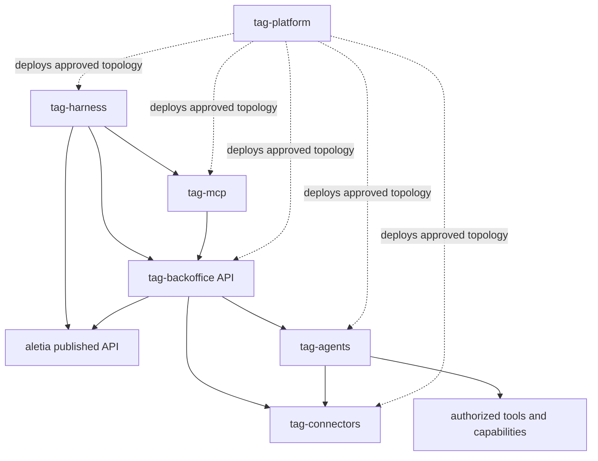

# Architecture

How TAG is divided into repositories, which way dependencies may point, and how code inside a repository is bounded. The detailed ecosystem architecture is private ([README](../README.md#where-the-other-documents-live)); this file holds the rules.

## Principles

1. One authoritative owner per domain.
2. No unnecessary duplication of business logic.
3. Dependencies flow toward stable contracts.
4. Authorization is enforced where protected resources are owned.
5. User experience is independent of agent execution.
6. Skills are independent of specific AI clients.
7. Domain MCP tools remain owned by their domains, except where an ADR moves a surface into `tag-mcp` ([MCP-STANDARDS](MCP-STANDARDS.md#ownership)).
8. External integrations belong to a connector layer.
9. Infrastructure is reproducible through code.
10. Every migration is reversible.
11. Every repository has meaningful blocking tests.
12. Existing business records and identities remain intact.
13. No production deployment without explicit human approval.

The aim is clear ownership, explicit contracts and independently deployable components **without unnecessary microservices**. A new service needs a reason that a module in an existing service cannot meet, recorded in an ADR.

## Ownership

| Domain | Owner | Notes |
| --- | --- | --- |
| Trust and business records: parties, Nexuses, permissions, append-only ledger | `aletia` | A standalone, blockchain-based product, not part of TAG, to be reorganized around DeFi and on-chain use. TAG consumes it only through its published APIs and never shares its database. |
| Agent definitions, capability metadata, generic agent execution, agent identity | `tag-agents` | Domain decisions stay in the domain that owns them. |
| External provider communication, OAuth connection lifecycle, provider credential custody | `tag-connectors` | Never decides whether a client may see a tenant's data. |
| Portable skills | `tag-skills` | Skills confer no permissions ([AGENTS-AND-SKILLS](AGENTS-AND-SKILLS.md#skills)). |
| Client-facing MCP servers | `tag-mcp` | [MCP-STANDARDS](MCP-STANDARDS.md). |
| Personal workspace experience | `tag-harness` | Presentation and interaction only. |
| Finance, People and Governance business execution | `tag-backoffice` | Its workflow engine decides *when* work runs; its domain handlers decide *what* is decided. |
| Shared infrastructure and deployment topology | `tag-platform` | The single infrastructure authority ([TERRAFORM](TERRAFORM.md)). |

There is no shared contracts repository: each owner publishes its own contracts ([ADR 0002](../docs/adr/0002-no-shared-contracts-repository.md), [API-CONTRACTS](API-CONTRACTS.md)).

## Dependency rules

These are logical dependencies on published contracts. They are **not** network permissions: every call is still authenticated and authorized by the owner of the resource.

### Forbidden dependencies

- aletia importing or calling TAG Harness, or depending on any TAG repository's internals.
- A domain core importing UI modules.
- Connectors importing business-domain workflows.
- A skill directly modifying an organization's ledger.
- An MCP server implementing accounting or other business rules.
- An agent using a global administrator identity to read customer data.
- A frontend bypassing authoritative authorization.
- More than one service implementing ledger-write semantics.

Where existing code breaks a rule, document the violation in the repository's `ARCHITECTURE.md` and remove it incrementally. Do not break working behaviour to make a diagram look cleaner.

## Module boundaries

Inside a repository:

- **Separate the core from its edges.** Domain logic lives in a core that depends only on ports (interfaces) it defines. Adapters for HTTP, databases, vendors, queues and models implement those ports at the edge. Existing hexagonal layouts are kept.
- **Organize by capability first, then by provider** (`providers/<provider>/`), as in `tag-connectors`. Do not rewrite working code only to impose a directory scheme.
- **Enforce boundaries in CI.** Python repositories declare import contracts with import-linter (the `boundary-command` of [`reusable-python-ci`](CI-CD.md#shared-workflows)). TypeScript repositories use ESLint import rules or dependency-cruiser in their `lint` script.
- **Nothing reaches into another repository's internals.** Cross-repository use goes through a published API, event schema, MCP tool or released package.

Directory and file naming rules are in [CODE-STYLE](CODE-STYLE.md#file-and-directory-names).

## Cross-organization analysis (future)

A personal agent may one day analyse data from several independently authorized organizations. Nothing in the current work implements this, and no service may build a permissive cross-company API or shared data pool. Designs must keep these concepts separate:

- person identity;
- organization membership;
- acting capacity;
- Nexus standing;
- authorization for each data source;
- permission to combine information;
- ownership of the resulting report;
- permission to disclose the result.

Each source must be authorized on its own. No service may aggregate several organizations' protected data because a user belongs to all of them.
